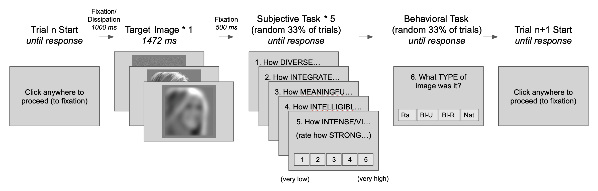

Measuring consciousness has been a longstanding problem. Although behavioral responses are commonly used, converging evidence indicates that behavioral responsiveness and behavioral reports about consciousness dissociate from consciousness per se. Measures of complexity applied to brain activity, such as Lempel-Ziv complexity and the perturbational complexity index, have been shown to discriminate between levels of consciousness, but less of this work has been done in the context of conscious content. To address many of the limitations of previous work, in this study we measure participants’ neurophysiological (EEG), subjective, and behavioral responses in states of normal wakefulness to visual and auditory stimuli that vary in granularity of subjective characteristics, such as meaningfulness. Two novel aspects of this study are that the stimuli are manipulated so that on initial trials they are mostly unrecognizable, but they can become recognizable on subsequent trials. This allows us to measure changes in EEG complexity that correspond to differences in phenomenology alone while completely controlling for stimulus complexity. In addition, we are investigating if any of five dimensions of subjective ratings correlate with any differences in EEG complexity. This study advances our understanding of consciousness by clarifying the relationship between stimulus complexity and measures of brain complexity and phenomenology.

<b>Figure 1</b>. Overview of the visual tasks. Each trial will begin with black text that reads “Click anywhere to proceed (to fixation)” displayed on a light grey background until the participant clicks the screen. After the click, a fixation cross will appear for 1 s to allow residual neural motor activity to dissipate, followed by the target image for 1.472 s (one of six categories/classes), followed by fixation for 500 ms. After a random 33% of the trials (to control for task demands), participants will rate their experience from 1 to 5 according to five dimensions (consecutively): 1) Diversity/Richness; 2) Integratedness/Unity; 3) Relevance/Meaningfulness; 4) Intelligibility/Understandability; and 5) Intensity/Vividness. On the same 33% of the trials (to control for attention), participants will indicate which stimulus class they experienced (Random, Blurred-UNrecognizeable, Blurred-recognizeable, or Natural). Each participant will complete 540 trials.

