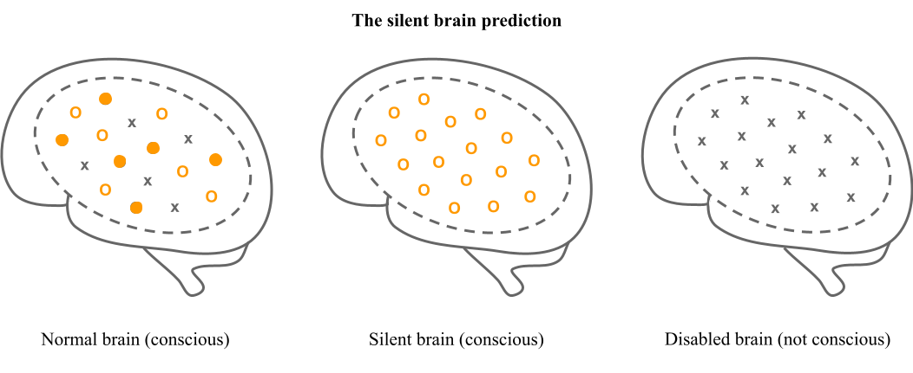
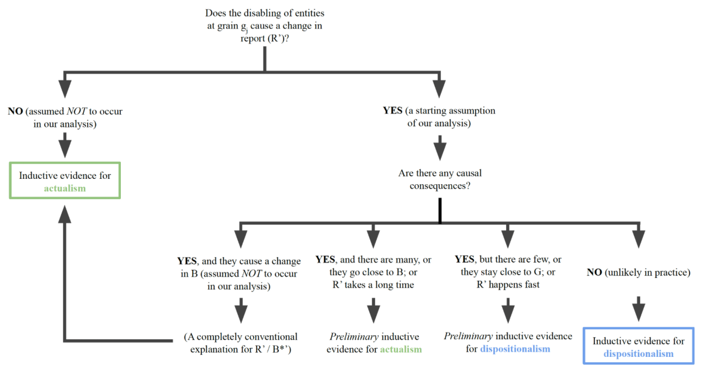

Integrated information theory (IIT) makes two predictions about the role of inactive neurons in consciousness. According to the silent brain (SB) prediction, rendering all active neurons inactive (“silent”) in the physical substrate of consciousness (the “main complex”) does not eliminate the presence of consciousness, because the neurons are still able to spike. According to the disabled neuron (DN) prediction, rendering a subset of silent neurons in the main complex no longer able to spike (“disabled”) can impact the qualitative character of experiences “nonconventionally” associated with those neurons. Bartlett (2022) argues that these predictions are untestable, because evidence for either prediction would imply that the testing conditions were not met. In this paper, we provide a detailed analysis of both silent neuron predictions, showing how they can in fact be tested. For the SB case, we clarify how a neural mechanism outside of the main complex can yield the required report of consciousness while maintaining the SB state. For the DN case, we distinguish between two ways of explaining how a neural mechanism could casually interact with the main complex: an IIT-inspired “dispositionalist” explanation, and a more conventional “actualist” explanation. Drawing on the work of Imre Lakatos, we conclude with a discussion of how the distinction between the two explanations sheds light on why it is so difficult to resolve theoretical disputes about consciousness. Despite these difficulties, we provide a framework that can lead to concrete progress for consciousness science.

<b>Figure 2</b>. Solid orange circles represent active (i.e., spiking) neurons; open orange circles represent silent neurons; and gray x’s represent disabled neurons. (Left) A typical brain state in which some neurons in the main complex are active, some neurons are not active and cannot fire (e.g., due to hyperpolarization), and some neurons are not active but could still fire (are merely silent), for example, if they were to receive sufficient synaptic input. (Middle) In the context of the silent brain prediction, all neurons in the main complex are silenced, and although there is no spiking activity, there would still be experience, because potential spikes are sufficient. (Right) By contrast, if all neurons in the main complex were disabled, consciousness would be absent.

<b>Figure 7</b>. A flowchart of the testing framework for the disabled neuron prediction and how different evidence supports actualism vs. dispositionalism.

